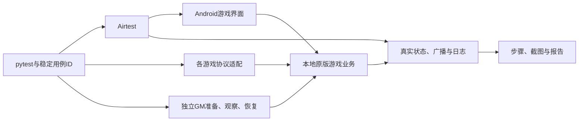

# Airtest Game QA

以 **Stendhal 1.49 RPG** 为主的本地游戏功能与自动化测试项目。Python/pytest 统一组织业务断言，Airtest 操作真实 Android 14 模拟器；原版协议桥连接玩家，独立管理员准备、读取和恢复角色数据。第二游戏 **Shardy** 接入同一配置、设备、接口通道和报告，验证框架复用。

已实现的核心业务覆盖购买及数量边界、取消与重复确认、背包堆叠和药水消耗、任务接取/拒绝/材料不足/奖励、经验升级、真实战斗及非法攻击/地图越界；另保留两条稳定检出 Shardy 原版缺陷的用例。第一批当时的 Stendhal 接口基准为23个独立执行ID，连续多轮115/115通过，其中第一批新增8个设计、14个子例、70次通过。详见[第一批用例讲解](docs/第一批用例讲解.md)和[实际多轮报告](docs/evidence/stendhal-api-batch1/index.html)。

新增任务界面流程：真实接取与交付、TravelLog正文、金币/经验/karma奖励、等级与生命显示、实际离线重登及防重复领奖。它与购买用例在新工作目录、新Python环境各连续多轮通过，共10/10；无观察重试，10次恢复核验通过。见[第二批界面讲解](docs/第二批界面用例讲解.md)与[最终多轮报告](docs/evidence/stendhal-ui-batch2-final/index.html)。当前37个正常执行ID各有多轮证据，合计185次通过；接口、任务/购买UI和Shardy沿用各自验收组，历史同ID复跑不重复相加。

新增装备与药水界面流程：长按Hold完成短剑合法槽往返，检查属性变化、非法feet拒绝与物品不丢失；两次真实Drink验证药水2→1→0、HP40→90→100封顶。两个新ID各连续多轮通过，共10/10、全部恢复且无观察重试。见[第三批界面讲解](docs/第三批界面用例讲解.md)与[本批多轮报告](docs/evidence/stendhal-items-ui-final/index.html)。

新增真实战斗界面：实际装备短剑，等待原版rat自然靠近后长按并选择一次Attack；核对击杀、XP800→805、尸体归属和玩家存活，清理rat/尸体后逐字段恢复角色。一个新执行ID连续多轮5/5通过，关联已有击杀设计。见[第四批讲解](docs/第四批战斗界面用例讲解.md)与[战斗UI多轮](docs/evidence/stendhal-combat-ui-final/index.html)。

新增跨系统闭环与三条接口异常：真实走过四张地图接取→购买→交付→升级→重登，金币20→10→30；无储位购买拒绝、远距近战无伤害、正伤害后取消攻击各连续多轮通过。四新ID共20次稳定通过，当前Stendhal为26 API＋6 UI，Shardy为4 API＋1 UI；39个实现ID另含2个保持failed的原版缺陷ID。受控定位失败保留首败和unstable，观察恢复不重复购买，独立原购买UI复跑无重试通过。见[第五批讲解](docs/第五批跨系统与异常用例讲解.md)与[汇总核验](docs/evidence/completion-verification.json)。

**完整功能验收尚未完成**：73条Stendhal设计中24条已有自动化接入，其余49条尚未接入。beer0接取日志由新任务链补足；SHOP-API-006只验无空间拒绝，满槽合并子例仍待验。任务与成长界面共用一个执行ID。状态详见[验收清单](docs/验收清单.md)与[功能用例目录](docs/功能用例目录.md)。

已完成[全仓逐文件精简审查与性能实测](docs/全仓精简审查与性能实测.md)：基线5,325个文件逐项登记，历史证据保持原样。固定报告组重建耗时减少93.39%，本机真实购买单例中位耗时减少3.39%；两者测量范围分别记录，最终43项框架检查通过（当时口径）。当前 `tests/` 自检 111 项通过；用例 marker 支持 `covers=["设计编号"]`，给没有独立 pytest 用例、只能共用执行证据的设计编号挂代码依据——只写在文档备注里的“已实现”不再算数，面板会单列「声明已实现但代码无据」。

[查看实际报告与录像](docs/evidence/index.html) · [环境部署](docs/环境部署.md) · [需求基线](docs/需求基线.md) · [框架能力与边界](docs/能力清单.md) · [用例清单](docs/用例清单.md) · [用例编写协议](docs/用例编写协议.md) · [实施记录](docs/实施记录.md)

## 实现结构

```text
src/gameqa/                 配置、设备、JSONL通道、证据、pytest执行和报告
cases/                     按稳定ID标记的真实游戏用例
adapters/stendhal_bridge/   官方Marauroa客户端与测试服GM数据助手
adapters/shardy_bridge/     原版WebSocket客户端适配
integrations/              客户端接入修复、第二游戏展示客户端、独立故障补丁
scripts/                   本地部署、账号准备、设备连接、真实录像
tests/                     框架自检，单独统计
docs/                      功能设计、规则、缺陷、部署与真实验收证据
reports/                   每次运行生成的新报告（不提交，样例在docs/evidence）
```



辅助能力不执行购买、领奖或击杀。业务动作由原版玩家会话或 Android 界面完成。API 角色 `qaplayera`、UI 角色 `qaplayer` 与管理员 `qaobserver` 分开，读取结果再次核对角色名。战斗使用原版 rat 属性及死亡奖励流程，仅添加精确清理夹具怪物/尸体的引用。

Stendhal 使用官方浏览器客户端，附一处初始化接入修复；Shardy 使用本项目编写的展示客户端连接原版后端，**未测试官方 Unity 客户端**。第三方来源与许可证见 [THIRD_PARTY.md](THIRD_PARTY.md)。

## 运行

部署 Java、Node、本地两款游戏和 Android 环境后，按[环境部署说明](docs/环境部署.md)生成本地配置和测试账号。当前实际验证 Python 3.12.14、pytest 9.1.1、Airtest 1.4.3；安装版本锁在 `requirements-lock.txt`。

```sh
python3.12 -m venv .venv
source .venv/bin/activate
pip install -r requirements-lock.txt
pip install --no-deps -e .
python -m pytest tests -q
```

配置路径用 `GAMEQA_CONFIG` 或 `--config` 指定；密码仅从环境变量读取。

```sh
# 主游戏接口与UI分别执行，避免抢占同一NPC；轮数按需自定。
python -m gameqa run --game stendhal --kind api --rounds 5
python -m gameqa run --game stendhal --kind ui --rounds 5
# 第二游戏正常组、原版缺陷组明确分开。
python -m gameqa run --game shardy --module core --kind api --rounds 5
python -m gameqa run --game shardy --kind ui --rounds 5
python -m gameqa run --game shardy --module known_defects --kind api --rounds 5
# 手动定位后只跑一个稳定ID。
python -m gameqa run --case ST-SHOP-API-001 --rounds 1
```

`--game`、`--module`、`--kind api|ui`、`--case` 为精确筛选；`--experiment` 标记独立实验。未指定过滤时会运行全部已实现用例，包含已知缺陷，预计返回失败。每轮使用独立 pytest 进程；新报告目录不能覆盖旧证据。HTML 含用例 ID、步骤、预期/实际、规则来源、截图、接口、日志、准备/恢复和单独重跑命令。

逐轮全量证据（每轮截图与完整报告）保留在本地；仓库只带各证据包的**入口页、摘要、核验文件与录像**，文档里的每个证据引用都由 `scripts/check_evidence_links.py` 校验存在且已入库（克隆后不断链）。

## 结果可信性

- 有副作用的业务动作不自动重发；发送后超时明确标为结果不确定。
- 观察/图像识别最多重试一次，保留每次尝试；恢复成功仍标记不稳定。
- 业务失败记 `failed`，前置或清理失败记 `error`，跳过记 `skipped`；后两类不能计入验收。
- “各轮判断一致”和“全部通过”分开统计。原版缺陷和注入缺陷保留失败，不使用 `xfail` 改成通过。
- 准备/恢复边界及不能恢复的世界状态明确列在[协议桥说明](adapters/stendhal_bridge/README.md)；并不声称完整世界回滚。
- 已保留一次由 UI 会话未释放造成的 NPC busy 失败，修正清理后重新回归；详情见实施记录。

独立故障服使用自己的端口和数据库，购物规则仍期望 60 金币，注入多扣后真实得到 59；结束停掉故障服，原版恢复组再次运行同一用例。原版 Shardy 两个缺陷报告见[反对角线未结算](docs/缺陷/Shardy-001-反对角线未结算.md)、[八步提前和局](docs/缺陷/Shardy-002-八步提前和局.md)。

仓库仅保留代码、固定版本规则、脱敏样例和录像；下载、数据库、SDK、账号密钥与模拟器数据放在私有运行目录。按用户选择保留为本地 Git 仓库，不发布到远程平台。
