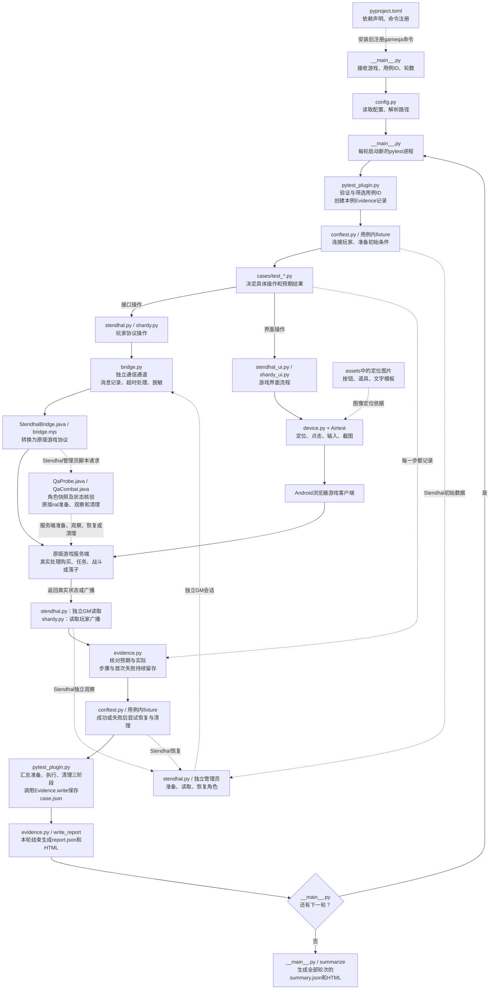

# 框架文件与运行流程

这张图对应当前实现，展示一次命令从启动、准备、业务操作、观察断言、恢复到报告的路径。实线表示主要控制流程或数据方向，虚线表示支持调用。多个用例会反复使用相同文件；同名文件在图中出现多次，表示它在不同阶段承担的工作。图中的公共通信文件会为不同玩家和管理员创建独立实例。

接口与界面是不同操作路径；Shardy界面用例还同时使用一个接口对手。准备和观察也可能经过相同通信工具。上图突出阶段与职责，具体fixture顺序由pytest的依赖关系决定。

## 六个共用核心文件

| 文件 | 主要函数/类 | 细化职责 |
|---|---|---|
| [__main__.py](../src/gameqa/__main__.py) | `main()`、`summarize()` | 接收游戏、模块、接口/界面、用例ID、轮数及报告目录；校验参数；每轮启动一个pytest子进程；保存该轮输出并读取报告；检查每个ID是否完整执行、结果一致、有无不稳定；生成跨轮JSON与HTML。它控制轮数，pytest插件负责其中一轮。 |
| [pytest_plugin.py](../src/gameqa/pytest_plugin.py) | pytest钩子；`qa`、`qa_config`、`game_config`、`bridge`、`android` fixture | 验证用例标签、ID格式及唯一性，按条件筛选；用例准备前创建Evidence；给用例提供配置、通信和设备；收集setup/call/teardown结果；清理后写单例记录；整轮结束调用报告生成器。准备或清理失败归为error。通信清理时保存接口消息及本例服务端日志。 |
| [config.py](../src/gameqa/config.py) | `load_config()`、`resolve_path()` | 从`--config`或`GAMEQA_CONFIG`读取TOML，保留配置文件位置；展开环境变量并以配置文件所在目录解析相对路径。密码值由使用账号的代码从环境变量读取。 |
| [bridge.py](../src/gameqa/bridge.py) | `Bridge`、`redact()`；三种错误类型 | 启动Java或Node协议桥进程，通过一行JSON一条消息发送请求；用请求ID核对响应；持续读取标准输出和错误日志；记录脱敏消息；关闭和重新建立通信进程。观察超时与业务结果不确定分别报错，通信层不会自动重发业务。脱敏每次调用读取一次密钥清单，递归处理嵌套数据。 |
| [device.py](../src/gameqa/device.py) | `AndroidDevice` | 通过Airtest连接Android；全屏或指定区域识别模板；点击、输入、按键和收起键盘；保存截图并登记附件；定位失败保留截图，并交给Evidence记录只读重试。输入日志限制用于避免打印凭据。 |
| [evidence.py](../src/gameqa/evidence.py) | `Evidence`、`write_report()` | `check`保存预期、实际与规则来源，失败抛出断言；`action`执行一次业务动作；`observe`记录观察尝试，默认允许一次暂态重试，首次失败仍保留并标记unstable；`attach`限制附件位于本例目录；`write`写单例JSON；`write_report`脱敏一次、转义HTML并生成本轮JSON和HTML。 |

Evidence在整个测试过程中持续记录。图中核对步骤位于操作后，并不表示要等测试结束才开始收集证据。

## 公共准备、游戏适配与底层接入

| 文件 | 细化职责 |
|---|---|
| [cases/conftest.py](../cases/conftest.py) | Stendhal公共fixture：`api_player`登录协议玩家；`observer`确保目标玩家上线后登录独立GM；`stendhal_ui`负责界面登录与关闭；`prepare`登记一次角色快照，最后恢复。UI恢复需要目标在线，必要时先重新登录。业务用例不必重复编写这套生命周期。 |
| [stendhal.py](../src/gameqa/stendhal.py) | 同一个类可以表示测试玩家或独立管理员，但使用分开的账号和通信实例。玩家执行动作和聊天；管理员核对目标角色、准备/恢复快照；`await_state`等待真实状态变化，`await_presence`核验上下线；`dialogue`每句只发送一次并读取NPC回复；辅助函数读取物品数量和任务阶段。`await_state`超时会返回末态，业务用例仍需明确断言。 |
| [stendhal_ui.py](../src/gameqa/stendhal_ui.py) | 组合底层点击与输入，完成登录、聊天、跨图行走、任务日志、物品菜单和槽位移动、图像断言、实际断开重登及释放NPC会话。地图点击和模板区域按本项目固定设备校准；行走后用独立服务端坐标确认到达。 |
| [shardy.py](../src/gameqa/shardy.py) | 连接原服、开始匹配、实际落子；按消息游标读取广播，更新真实棋盘、比分及轮次；结束时先exit或stop，再disconnect。Shardy不使用Stendhal的GM快照；前置和清理由自己的用例fixture负责。 |
| [shardy_ui.py](../src/gameqa/shardy_ui.py) | 打开本项目的展示客户端，点击连接和匹配，按定位锚点计算棋盘格子位置；执行界面落子，并在格子区域识别X/O图像。对手的匹配/落子由`shardy.py`执行。 |
| [StendhalBridge.java](../adapters/stendhal_bridge/StendhalBridge.java) | 使用官方Marauroa客户端连接Stendhal；把Python的JSON请求转成登录、玩家动作及管理员脚本请求；处理原服感知、状态、聊天与事件，再返回JSON。 |
| [QaProbe.java](../adapters/stendhal_bridge/QaProbe.java) | 在本地测试服由管理员调用：保存角色快照、设置允许的初始数据、独立读取角色及地面状态、恢复声明范围并核验。限制测试角色与操作字段；不代替玩家购买、领奖或攻击。角色恢复不等于整个数据库/世界回滚。 |
| [QaCombat.java](../adapters/stendhal_bridge/QaCombat.java) | 准备原版属性与AI的rat，读取其位置、生命、距离等，最后停止夹具战斗/寻路并清理指定怪物和尸体。入口fixture在[基础战斗用例](../cases/test_stendhal_combat.py)，战斗结束先清理怪物/尸体，再恢复角色。 |
| [bridge.mjs](../adapters/shardy_bridge/bridge.mjs) | 使用Shardy客户端SDK连接原版WebSocket后端；接受Python的一行JSON命令，处理匹配、落子、退出与消息查询，保留原服广播和状态。协议及SDK日志进入错误通道，正式响应留在JSON通道。 |

Shardy API用例使用两个真实协议玩家；UI用例使用Android展示客户端和一个协议对手。其玩家创建、配对和清理分别在[test_shardy_api.py](../cases/test_shardy_api.py)与[test_shardy_ui.py](../cases/test_shardy_ui.py)。图中的“用例内fixture”也包括这些文件以及战斗夹具，并非所有准备都写在conftest。

## 包与配置文件

| 文件 | 作用 |
|---|---|
| [pyproject.toml](../pyproject.toml) | 声明Python版本、pytest/Airtest依赖、包位置、`gameqa`命令入口及pytest标签。它是安装配置。 |
| [__init__.py](../src/gameqa/__init__.py) | 组织并说明`gameqa`包，当前没有独立运行逻辑。 |
| [config.example.toml](../config.example.toml) | 配置格式示例；提供设备、游戏地址、协议桥与账号环境变量名称的填写方式。实际运行配置另由`--config`或环境变量指定。 |

## 用购买用例走一遍

选择`ST-SHOP-UI-001`后，入口读取配置，pytest插件找到这条用例并创建记录。公共fixture登录Android角色和独立GM，保存角色原始状态，然后准备100金币和0个cheese。

用例调用`stendhal_ui.py`发送NPC对话；它调用`device.py`在实际界面输入并确认购买。网页客户端将动作发送到原服，原服扣40金币并发2个cheese。

用例调用`stendhal.py`等待独立GM读取到真实结果；通信经过`bridge.py`、`StendhalBridge.java`和`QaProbe.java`。`evidence.py`分别检查金币60和cheese2，这两个检查点属于同一条用例。

测试后恢复快照，再关闭界面与通信会话。插件记录三个阶段的结果并写`case.json`；本轮结束写`report.json/index.html`；若还有轮次则重新启动pytest，全部轮次完成后写总汇总。购买、聊天和攻击不会因观察失败被自动重发。
